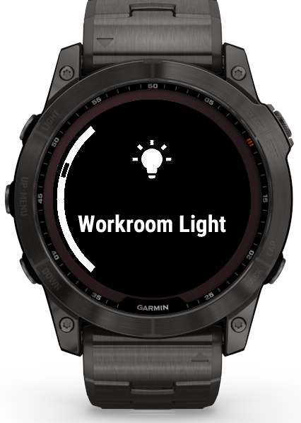
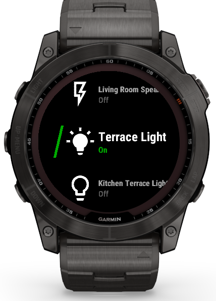
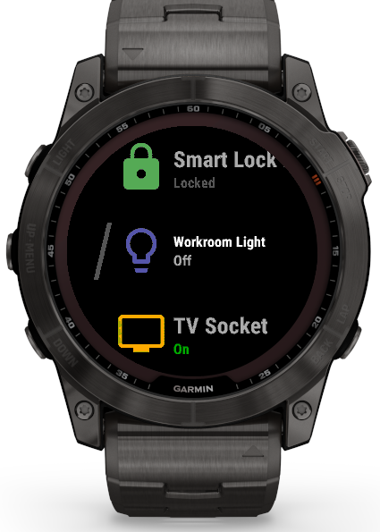

## HassControl

A garmin widget to interact with [Home Assistant](https://www.home-assistant.io/).


The widget aims to be simplistic but still provide the most basic functionality, such as triggering scenes or toggling lights and switches.

Due to limitations by both Garmin and Apple/Android some setup steps will be more cumbersome than what I would have preferred.

Please read through the instructions below, I will try to guide you through the steps :)

- [HassControl](#hasscontrol)
  - [Prerequisites](#prerequisites)
  - [Supported entity types](#supported-entity-types)
  - [Custom icons](#custom-icons)
  - [Low-memory devices](#low-memory-devices)
  - [Installation](#installation)
  - [Configuration](#configuration)
    - [Basic Settings](#basic-settings)
    - [Entity Synchronization](#entity-synchronization)
    - [Display](#display)
    - [Battery and Performance](#battery-and-performance)
    - [Authentication Options](#authentication-options)
    - [Lock confirmation](#lock-confirmation)
  - [Logging in](#logging-in)
  - [Group sync](#group-sync)
  - [Navigation \& Controls](#navigation--controls)
  - [Without the phone: waiting, Wi-Fi and LTE](#without-the-phone-waiting-wi-fi-and-lte)
  - [Header Authentication](#header-authentication)
  - [FAQ](#faq)
    - [Unknown error -300 - Self-Signed SSL Certificate](#unknown-error--300---self-signed-ssl-certificate)
    - [Error message: "Check settings, invalid url"](#error-message-check-settings-invalid-url)
    - [Some entities from my group are missing in my Garmin device](#some-entities-from-my-group-are-missing-in-my-garmin-device)
    - [Changed entity state doesn't show immediately in HassControl](#changed-entity-state-doesnt-show-immediately-in-hasscontrol)
    - [Error message: "Group too large for this watch"](#error-message-group-too-large-for-this-watch)
    - [Error message: "Low memory: only N of M entities loaded"](#error-message-low-memory-only-n-of-m-entities-loaded)
    - [My watch has no "List View" option, or ignores custom icons](#my-watch-has-no-list-view-option-or-ignores-custom-icons)
    - [Error message: "PIN locked"](#error-message-pin-locked)
    - [Wi-Fi/LTE: the sync fails with "Unknown error (0)"](#wi-filte-the-sync-fails-with-unknown-error-0)


### Prerequisites
In order to use this widget you need to have an Home Assistant instance accessible over https using an official SSL certificate (no self-signed).
On watches other than the [low-memory devices](#low-memory-devices), the widget accepts plain `http://` for one exception: the phone itself (`http://localhost`, `http://127.0.0.1` or `http://[::1]`), meant for a local proxy app on the phone that forwards to Home Assistant. Whether the Garmin Connect app passes such requests on has not been verified - see [Host](#basic-settings).

As all communication from Garmin watches go thru the mobile device, you also need to have a paired mobile phone, and the Garmin Connect app needs to be running on that phone.

As soon as you get out of range from the phone or closes the app the widget will stop functioning - unless your watch has Wi-Fi or LTE and you enable sending actions over it, see [Without the phone](#without-the-phone-waiting-wi-fi-and-lte).


### Supported entity types
Currently only following Home Assistant entities are supported:

 Entity type   | Note
---------------|-----------------------------------------------------------------------------------------------------------------------------------------------------------------------
 binary_sensor | Only displays basic boolean state, device class is not supported.
 input_boolean | Toggling of its state is supported.
 light         | Only turning on/off is supported, the rest like colour, brightness, etc. are not supported.
 button        | Push/Trigger a button
 input_button  | Push/Trigger an input button
 lock          | Both locking and unlocking are supported, optionally behind a yes/no question or a PIN - see [Lock confirmation](#lock-confirmation).
 cover         | Both closing and opening the cover is supported.
 fan           | Turning on and off is supported. Changing speed is not.
 switch        | Only turning on/off, energy consumption and standby mode are not supported.
 valve         | Opening and closing is supported. Stopping and setting a position are not.
 automation*   | Can be turned on/off.
 scene*        | Execution
 script*       | Execution
 sensor        | Display values for the following sensor types: temperature, humidity, CO2, PM10, PM25, energy, gas and water (others will be displayed but won't have a proper icon).
 select / input_select | Pick one of the entity's configured options. See [Navigation & Controls](#navigation--controls) for how this works. Read-only on [low-memory devices](#low-memory-devices).
 input_number / number | Set a numeric value, honoring the entity's `min`/`max`/`step`. See [Navigation & Controls](#navigation--controls) for how this works. Read-only on [low-memory devices](#low-memory-devices).


\* marked are not entities in the true sense of the word, but why have two tables

### Custom icons
By default each entity is drawn with an icon based on its type and state (e.g. every
`script.*` shares one icon). If an entity has a custom [Material Design Icon](https://pictogrammers.com/library/mdi/)
set in Home Assistant — via the entity's `icon:` (YAML) or the UI *Settings → Icon* field —
HassControl now uses that icon instead, when it's one of the bundled glyphs.

```yaml
# scripts.yaml — the script now shows a film-reel icon on the watch instead of the generic script icon
movie_mode:
  alias: Movie mode
  icon: mdi:movie-open
  sequence: ...
```

Set icons are matched against a bundled subset of MDI (lights, plugs, media, climate,
covers/blinds, security, weather, appliances, and more — see `getMdiMap()` in
`widget/source/Utils.mc`). An entity whose icon isn't in the bundled
set simply falls back to the default type/state icon, so nothing breaks.

If an entity has no custom icon but does have a `device_class` (for example `battery`,
`temperature` or `door`), HassControl uses the icon Home Assistant's own UI would show
for that class before falling back to the type/state icon.

To add another icon: drop a 60×60 white-on-transparent PNG in `widget/resources/drawables/`,
register it in `drawables.xml`, and map the `mdi:*` name(s) to it in `getMdiMap()`.

***Note:*** *Custom icons are not available on [low-memory devices](#low-memory-devices).*

### Low-memory devices

Some older watches give a widget only **64 KB of memory** — for everything: the app's own
code, all entity data, and every network response. As HassControl grew, the full feature
set stopped fitting, and the widget ran out of memory on these devices.

To keep them working, HassControl is built with a reduced feature set for the watches
listed below. Everything else — scenes, group sync, colored icons, battery reporting,
header authentication — works exactly as documented, though `select`/`input_select` and
`input_number`/`number` are read-only there (see below) rather than editable.

| Affected watches |
|------------------|
| Descent G1 / G1 Solar · Enduro · fēnix 5 · fēnix 5S · fēnix 6 / 6S (incl. Solar and Dual Power) · fēnix Chronos · Forerunner 55 / 245 / 645 / 935 · Instinct 2 / 2S / 2X Solar (incl. Solar, Dual Power, dēzl Edition) · Instinct Crossover · Venu Sq · vívoactive 3 |

**What is different on these watches:**

- **[Custom icons](#custom-icons) are not available.** Entities always use the icon for
  their type and state. The `icon:` and `device_class` attributes are ignored. `select`/
  `input_select` and `input_number`/`number` also lose their own distinctive icon on these
  watches, falling back to the same generic icon an unrecognized sensor gets.
- **Only the classic card view is available.** The 3-row list view is not built for these
  watches, so the `List View` entry is absent from the watch menu and the
  `Use list view style` setting in the ConnectIQ app has no effect. See [Display](#display).
- **`select`/`input_select` and `input_number`/`number` are read-only.** These watches
  display the entity's current option/value, the same way a plain sensor is displayed, but
  there's no menu or edit screen to change it - do that from Home Assistant or another
  device instead. See [Navigation & Controls](#navigation--controls).
- **No [lock confirmation](#lock-confirmation).** Locks are locked and unlocked right away;
  the `Confirm before locking/unlocking a lock` and `Lock PIN` settings have no effect.
- **No [waiting for the phone, Wi-Fi or LTE](#without-the-phone-waiting-wi-fi-and-lte).**
  Without the phone the widget shows `Phone not connected` and closes, as before; the
  `Send actions over Wi-Fi/LTE` setting has no effect.
- **https only.** The `http://localhost` exception for a proxy on the phone is not available.

**Safeguards.** Even with the reduced feature set, a large Home Assistant group can exceed
what these watches can hold. Rather than crashing, HassControl now stops and tells you:

- Importing stops early with `Low memory: only N of M entities loaded`.
- If the group response itself is too large to receive, you get `Group too large for this watch`.
- A state refresh that runs low on memory stops early; the remaining entities keep their
  last known state and are updated the next time you open the widget.

In all three cases the fix is the same: put fewer entities in your group. See the
[FAQ](#faq) entries below.

***Note for other watches:*** *newer devices have 512 KB or more and are unaffected — they
get the complete feature set.*

### Installation
The easiest way to install the app is to download and install the [ConnectIQ app](https://support.garmin.com/en-US/?faq=mmm2rz2WBI3zbdFQYdiwX8) from Garmin on your smartphone.

Once you have the app installed on your paired phone you can browse for widget and find the app by name, [HassControl](https://apps.garmin.com/en-US/apps/3dce2242-473f-4f13-a6a9-299c3686611f).

### Configuration
Open the widget settings in the ConnectIQ app.
[How to Access the Settings of a Connect IQ App Using the Garmin Connect App](https://support.garmin.com/en-US/?faq=SPo0TFvhQO04O36Y5TYRh5)

#### Basic Settings

**Host**: This should be the url to the Home Assistant instance you would like to control. Remember only https url is supported by Garmin.

The one exception (not on [low-memory devices](#low-memory-devices)): plain http to the phone itself - `http://localhost`, `http://127.0.0.1` or `http://[::1]`, followed by nothing but an optional port and path, e.g. `http://localhost:8123`. Upper or lower case does not matter (`Http://localhost` is accepted too). Only the host itself counts: `http://localhost.example.com` is a different host and is still rejected. As every request goes through the phone, this is meant to reach a server running on the phone, such as a local proxy app forwarding to Home Assistant on your network. The widget accepts such a host, and it works in the Connect IQ simulator, but whether the Garmin Connect app on the phone relays plain http to the phone itself has not been verified - iOS and Android restrict unencrypted (cleartext) connections, which may block it. Such a host cannot be used [over Wi-Fi/LTE](#without-the-phone-waiting-wi-fi-and-lte), where the watch connects by itself.

**Long-Lived access token**: If you prefer generating an access token in Home Assistant instead of login in thru the garmin app you can paste your token here.

#### Entity Synchronization

**Scenes**: Since scene names aren't that configurable in Home Assistant you can override the names in this box. Multiple overrides can be specified by separating them with a comma (,).

So for example; If you have the scene `scene.good_bye` and `scene.movie` the configuration string could look like this: `good_bye=Good Bye, movie=Movie`, or `good_bye, movie`.

You can also use this field to "import" scenes if you don't want to create a group in Home Assistant as described below.

**Group**: In this box you can write a single group from Home Assistant, this group can then be used from within the widget to import all entities contained in that group.

I will describe this procedure in more detail below.

***Note:*** *The default start view is filtered to scenes and will not show light, switches etc., the start view can be changed in the widget settings in your Garmin device.*

#### Display

**Use list view style**: When enabled in settings (disabled by default), entities are shown as a scrollable 3-row list — previous, current, and next entity — with the selected row highlighted and a colored accent bar indicating the entity state (green = active/open, orange = transitional, blue = sensor value, purple = scene/script/button trigger, gray = inactive).

When disabled, entities are shown in the classic style: one full-screen card per entity with a large centered icon and the entity name below it.

This setting can be changed in two places, and both stay in sync:

- In the **ConnectIQ app** on your phone: open the widget settings and toggle `Use list view style`.
- On the **watch**: open the widget menu, go to `Settings`, and toggle `List View` (`3-row list` / `Classic card`). The change is applied immediately and persisted to the app settings.

***Note:*** *On [low-memory devices](#low-memory-devices) only the classic card view is available; the `List View` menu entry is absent and this setting has no effect there.*

**Colored icons**: State icons are tinted to match Home Assistant's default state colors, so you can tell an entity's state at a glance. This works in both the list view and the classic view.

| State | Colored icons on | Colored icons off (mono) |
|-------|------------------|--------------------------|
| on / open | amber `#FFC010` | 100% white |
| off / closed | blue `#46729D` | 50% white |
| unlocked | red `#F44539` | 50% white |
| locked | green `#4DAD51` | 100% white |

Sensors, scene/script/button triggers, and transitional states (opening, closing, locking, unlocking) are not tinted and keep their normal rendering.

Because there is no reliable way for the watch to detect whether a display supports color, this is a manual setting. Enable `Colored icons` in the ConnectIQ app widget settings (disabled by default) to use the full Home Assistant colors. Leave it disabled on monochrome/limited displays to use white brightness instead (100% white for active/secure, 50% white for inactive/alert).

<p>
  
  
  
</p>

#### Battery and Performance

**Refresh on show**: When enabled, the widget will refresh entity states every time it's opened. This provides more up-to-date information but uses more battery and network resources.

**Close after action**: When enabled, the widget will automatically close after successfully controlling an entity (turning a light on/off, activating a scene, etc.). This can save battery but requires reopening the widget for additional actions.

**Auto-close after inactivity**: Configure the number of seconds of inactivity after which the app will automatically close. Set to 0 to disable this feature (default). Valid range is 0-300 seconds. This helps conserve battery by ensuring the widget doesn't stay open indefinitely.

**Battery percentage reporting**: Configure an arbitrary entity name (a-z, 0-9, _) to which the battery status of the watch should be reported.
e.g., "venu2_battery" (**excluding** the "sensor." prefix)
The battery value is being sent to Home Assistant once - when the app is started. Except on [low-memory devices](#low-memory-devices): if the phone is not connected then, it is sent once the phone connects - provided that happens within the 3 minutes the widget waits for it (see [Waiting for the phone](#without-the-phone-waiting-wi-fi-and-lte)).
The corresponding entity is created automatically (e.g., "sensor.venu2_battery").

***Optionally***, you can configure a dedicated entity **before** the first use:

```
- template
  - sensor:
      - name: My Garmin Device
        device_class: "battery"
        unit_of_measurement: "%"
        state: 0
        unique_id: MyGarminDevice123
```
Then enter the corresponding entity name in the ConnectIQ app settings (excluding the "sensor." prefix)
e.g., "my_garmin_device"

#### Authentication Options

**Additional HTTP(S) Header - Key/Value**: These two fields allow you to specify a custom HTTP header to be added to all requests from the widget to Home Assistant. This can be used for additional authentication or for passing custom information to proxy servers. See the [Header Authentication](#header-authentication) section for more details.

#### Lock confirmation

**Confirm before locking/unlocking a lock**: What happens when you select a `lock` entity:

- `Off` (default): it is locked or unlocked right away.
- `Yes/no question`: the watch asks first, e.g. `Unlock Front Door?`.
- `PIN`: you enter the PIN set in **Lock PIN** first.

**Lock PIN**: Exactly four digits. If `PIN` is selected but no valid PIN is set, locks cannot be operated from the watch at all (`Lock PIN not set`) - the widget does not fall back to no PIN.

Entering the PIN works like the passcode of the Garmin Pay wallet:

- Four slots at the top fill up as you enter digits - the digits themselves are never shown - and the PIN is checked as soon as the fourth one is in.
- On **touchscreen** watches you tap the digits on a keypad. The buttons work as well: up/down move a highlight over the keys and select presses it (for watches with the touchscreen switched off).
- On **button** watches you choose each digit on a wheel with up/down and take it with select.
- Back deletes the last digit, or leaves the screen when there is none.
- After a wrong PIN you can try again. **Three wrong entries in a row lock it**, also across restarts of the widget, until you **set a new PIN** in the app settings - just as the wallet has to be reset in Garmin Connect. A correct entry resets the count.

The settings exist in the ConnectIQ app only, on purpose: a switch on the watch would let anyone holding the watch turn the PIN off.

***Note:*** *Not available on [low-memory devices](#low-memory-devices).*

### Logging in
Once you have configured all settings in the ConnectIQ app, the next step will be to login.

***Note:*** *If you've setup the `Long-Lived access token` you should be logged in automatically and can skip to the next section.*

Since the watch doesn't have an suited interface for logging in to web pages, the login will be performed with the help of your paired smartphone.

Before you get started, make sure that you have installed and paired your watch in the [Garmin Connect](https://connect.garmin.com/start/) app.

If you don't have push notifications turned on, make sure the app is running before proceeding.

To login, simply open the widget and trigger any scene. Shortly after, you will see a sign in request on your smartphone. Complete the sign in process on your phone and return to the watch.

You should now be able to trigger your scenes.

If you don't have any scenes, you can login by pressing and holding on the screen (long press) or using the menu button on your watch and logging in from the widget menu.

If you don't see any login request on your phone. Restart the widget after you have opened the garmin Connect app and the watch has been connected.

If you are having problems logging in or if the widget is logged out frequently, you can also generate a `Long-Lived access token` for your user in Home Assistant and paste it to the Connect IQ settings. This will bypass the normal login flow and use that token to communicate with Home Assistant.


### Group sync
Due to the limitations of the watch, there is no really good way of listing and adding entities directly from the watch.
But the easiest way to add your entities is by [creating a new group](https://www.home-assistant.io/integrations/group/#old-style-groups) in Home Assistant, and add all your entities there. **Note that "old style groups" MUST be used, and cannot be edited with the "groups" UI.**

Your group configuration can look like this:
```
# Example configuration.yaml entry
group:
  garmin:
    name: Garmin
    entities:
      - light.bathroom
      - switch.tv
      - script.turn_lights_for_10_min
```
Or if your `configuration.yaml` looks like `group: !include groups.yaml`, omit the leading `group:`
```
# Example groups.yaml entry
garmin:
  name: Garmin
  entities:
    - light.bathroom
    - switch.tv
    - script.turn_lights_for_10_min
```
***Note***: *Remember after changing the configuration, you have to either reload the groups or restart the Home Assistant.*

Then write the id of the group you have just created (in our case `group.garmin`) into the ConnectIQ app widget settings as described [above](#configuration).

Once you have added the group into ConnectIQ app widget settings, open the widget on your Garmin device and access the menu (either by using a long press on the screen or pressing the menu button). Then go into `Settings` and select `Refresh entities`.
Once that is done, all entities added to that group in Home Assistant and supported by HassControl will be imported and available on the watch.

If you done some modification to the group in Home Assistant, you can at any time repeat this procedure to add, update or remove entities from your watch.

***Note:*** *On [low-memory devices](#low-memory-devices) the number of entities a group may contain is limited by the watch's memory. If your group is too large you will be told during the import rather than getting a crash — see the [FAQ](#faq).*

### Navigation & Controls

The widget is designed to be as simple as possible, but there are a few things to keep in mind.

Entities can be displayed in two styles — a 3-row list (default) or the classic full-screen card view. See [Display](#display) for how to switch between them. Navigation works the same in both styles.

***Note:*** *"Select" and "Back" below refer to physical buttons where your watch has them. On touchscreen watches without a dedicated Select or Back button, tap the middle of the screen for "Select" and swipe right for "Back".*

- **Scrolling**: Depending on your watch model, you can scroll through the widget using the touchscreen or the up/down buttons. If your watch has a touchscreen, you can also use the swipe gesture to scroll.
- **Selecting an entity**: To select an entity, simply scroll to it and press the "Select" button (usually the middle button on the right side of the watch).
- **Toggling a switch or light**: To toggle a switch or light, select the entity and press the "Select" button again. The entity should now be toggled on or off.
- **Triggering a scene or script**: To trigger a scene or script, select the entity and press the "Select" button. The scene or script should now be executed.
- **Refreshing entities**: If you have made changes to your entities in Home Assistant and want to update the widget, you can select the "Refresh entities" option in the widget menu. This will reload all entities from Home Assistant.
- **Choosing a `select`/`input_select` option**: Select the entity and press the "Select" button. This opens a menu listing the entity's options — pick one to send it to Home Assistant. On [low-memory devices](#low-memory-devices) these entities are read-only instead: they just display the current option and pressing "Select" does nothing.
- **Setting an `input_number`/`number` value**: Select the entity and press the "Select" button. This opens a dedicated screen with the current value in the middle and "+"/"-" bands at the top and bottom; use up/down (or tap/swipe those bands) to adjust the value by the entity's configured step, respecting its min/max, then press "Select" (or tap the value) to confirm, or "Back" to cancel. On [low-memory devices](#low-memory-devices) these entities are read-only instead: they just display the current value and pressing "Select" does nothing.

HassControl also supports the following controls:

- **Single tap/press**: Toggle the current entity (turn lights on/off, activate scenes, etc.)
- **Menu button**: Open the menu
- **Long press**: Open the menu (alternative to using the menu button)
- **Swipe/Page buttons**: Navigate between entities

On touchscreen devices, the long press gesture provides a convenient way to access the menu without using the physical menu button.

### Without the phone: waiting, Wi-Fi and LTE

***Note:*** *This section does not apply to [low-memory devices](#low-memory-devices).*

**Waiting for the phone.** If you open the widget while the phone is not connected, and you are logged in (or [battery reporting](#battery-and-performance) is set up), it shows `Waiting for connection` instead of failing with `Phone not connected` and closing. Once the phone connects, the loader disappears and the entity states are refreshed (and the battery level is reported, if set up). Press back to leave the loader and look at the last known states in the meantime; the refresh still happens once the phone is back.

The widget waits for up to 3 minutes. Then it gives up: the loader disappears and the last known states stay on screen.

No loader is shown in two cases - the widget then waits quietly, and still refreshes once the phone connects:

- When Wi-Fi/LTE (see below) can be used: you can act on the last known states right away.
- On watches without widget glances (or with glances turned off), where the widget opens on its `HassControl` title page: that page stays usable, so you can still scroll on to the next widget.

Actions you take without the phone (and without Wi-Fi/LTE) still show `Phone not connected` and close the widget about 2.5 seconds later - except while the widget is still waiting for the phone after you opened it: then only the message is shown.

**Edge bike computers.** Edge units with Wi-Fi keep it switched on whenever no activity is being recorded. While their Wi-Fi is connected, the widget talks to Home Assistant over it directly, just as through the phone: the states are refreshed (this also ends the wait at startup), and actions are sent right away, without a sync - the Wi-Fi/LTE setting below is not needed for that. This is based on Garmin's device data and forum; it has not been tested on an Edge.

**Wi-Fi/LTE.** Watches with Wi-Fi or LTE can send actions without the phone, the way [GarminHomeAssistant](https://github.com/house-of-abbey/GarminHomeAssistant/blob/main/Wi-Fi.md) does it. Enable `Send actions over Wi-Fi/LTE when the phone is not connected` in the app settings. Then, while the phone is not connected, selecting an entity asks e.g. `Unlocking Front Door via Wi-Fi/LTE?`; confirm, and the watch starts a sync - the system sync screen - during which it sends the action to Home Assistant itself. With Wi-Fi/LTE available the widget still waits for the phone at startup, but without the `Waiting for connection` loader (see above).

Limits:

- **Actions only.** Entity states are not refreshed over Wi-Fi/LTE: you see and act on the last states known from the phone. Toggling uses those states, so e.g. a light already switched on elsewhere may be switched on again rather than off.
- **Slow.** The watch first has to join your Wi-Fi access point (or the LTE network), which takes a while, and Wi-Fi/LTE use costs battery. Treat it as a last resort, not a way of operating.
- **https only**, and the watch does the TLS handshake itself. Some Garmin models only offer cipher suites without forward secrecy over Wi-Fi, which many servers (Nabu Casa, Cloudflare, current nginx/Apache defaults) refuse - see the [FAQ](#wi-filte-the-sync-fails-with-unknown-error-0). An `http://localhost` host cannot be used here.
- **Public DNS.** Over Wi-Fi, watches look host names up with public DNS servers rather than your router's, so a name that only exists in your home network (from a local DNS server or override, or `homeassistant.local`) cannot be found. The host has to resolve on the internet.
- You have to be in range of the Wi-Fi access point configured on the watch. LTE reaches further, but your carrier may charge for it - and some LTE models do not let Connect IQ apps use LTE at all, e.g. the Fenix 8 Pro and Fenix 9 Pro (GarminHomeAssistant issues [#292](https://github.com/house-of-abbey/GarminHomeAssistant/issues/292) and [#385](https://github.com/house-of-abbey/GarminHomeAssistant/issues/385)).
- **Only on watches with the sync API.** The setting does nothing on models whose Connect IQ lacks it, e.g. the Forerunner 255/255S, Venu Sq 2, Instinct 3, Instinct E, Instinct Crossover AMOLED, Edge Explore, Edge Explore 2, Edge MTB, Edge 520 Plus, Edge 820, Fenix 5X, GPSMAP 67 and Montana 7xx.
- Below Connect IQ 4.0.4, the sync screen shows Garmin's generic sync text instead of the action.
- On Edge units with Wi-Fi the question only comes up while their Wi-Fi is not connected, e.g. during an activity; otherwise the widget talks to Home Assistant directly (see above).
- The [lock confirmation](#lock-confirmation) still applies. With `Yes/no question`, the Wi-Fi/LTE question is the only one asked.
- A confirmed action that cannot be sent within one minute is dropped - as is one whose sync you cancel, or one still waiting the next time you open the widget - so an unlock can never happen unexpectedly on some later automatic sync.
- If the sync ends with `Sent, reply unreadable`, the action reached Home Assistant, but the watch could not read the reply (it lists every state the action changed, which can be a lot). The action has most likely been carried out.

### Header Authentication

Since `v1.5.0` it's possible to specify an arbitraty header in the settings.
It's being added to all requests from the ConnectIQ device.
This can serve for authentication - e.g., like available for Cloudflare: https://developers.cloudflare.com/workers/examples/auth-with-headers/

If you use Caddy, you can implement this in the following way:

```
my-home-assistant.com {
     @headerauth {
         header X-Custom-PSK MY-PRE-SHARED-KEY
     }
     handle @headerauth {
        reverse_proxy 192.168.0.1:8123 {
          header_up -X-Custom-PSK
          header_up X-Forwarded-Host {host}
        }
     }
     respond 403
 }
```

### FAQ

#### Unknown error -300 - Self-Signed SSL Certificate
Are you using a self-signed certificate? Unfortunately, this is not supported.
Importing your certificate on the phone only makes it available on the phone.
It would have to be added on the watch (which is - at least currently - not possible)
So having an "official" SSL certificate is currently a must-have.
You can get them either by using the Caddy config below or use Let's Encrypt directly or by buying a certificate - which have become quite cheap.

See also https://github.com/hatl/hasscontrol/issues/17 for further details.

```
home-assistant.mydomain.com {
    @internal {
        remote_ip 192.168.0.0/24
    }
    handle @internal {
        reverse_proxy 192.168.0.1:8123 {
        header_up X-Forwarded-Host {host}
      }
    }
    respond 403
}
```

#### Error message: "Check settings, invalid url"
Check if you are using correct url with `https` prefix, because only secure HTTPS communication is allowed. This limitation comes from Garmin.

The one exception is plain `http://` to the phone itself - `http://localhost`, `http://127.0.0.1` or `http://[::1]`, followed by nothing but an optional port and path, in upper or lower case (not on [low-memory devices](#low-memory-devices)). Whether the Garmin Connect app relays such requests has not been verified, see [Host](#basic-settings).

#### Some entities from my group are missing in my Garmin device
Not all Home Assistant entity types are currently supported by HassControl, you should take a look at [supported entity types table](#supported-entity-types).

#### Changed entity state doesn't show immediately in HassControl
There is a rare occasion when someone changes state of an entity (for example turns the light on), while you are actively using this widget. In this case its state in your Garmin device will not correspond to its actual one. It has to be synced again. There are three option how to sync it. You either toggle it's state, select `Refresh entities` in `Settings` or reopen the widget (the state of all your entities is automatically received from Home Assistant every time you start the widget).

***Note***: *Because after predefined timeout period every widget is automatically closed, you should never experience this type of data discrepancy.*

#### Error message: "Group too large for this watch"
Your watch is one of the [low-memory devices](#low-memory-devices) and the group you are importing has more entities than it can receive — the response could not even be read into memory.

Remove entities from the group in Home Assistant until the import succeeds. A group of roughly a dozen entities is a realistic target on these watches; the exact number depends on how long your entity ids and names are.

#### Error message: "Low memory: only N of M entities loaded"
The group was received, but your watch ran out of room while creating the entities, so HassControl imported the first N and stopped. The N that were imported work normally.

This is a deliberate safeguard on [low-memory devices](#low-memory-devices) — the alternative was the widget crashing mid-import. Shrink the group in Home Assistant to the number your watch reports it managed, then run `Refresh entities` again.

#### My watch has no "List View" option, or ignores custom icons
Your watch is one of the [low-memory devices](#low-memory-devices). The 3-row list view and the Home Assistant `icon:` / `device_class` icons are not built for those watches, because the memory they need is memory those watches don't have. Everything else works normally.

#### Error message: "PIN locked"
The lock PIN was entered wrong three times in a row, so lock control is blocked - like the Garmin Pay wallet after three wrong passcodes. Set a new PIN under `Lock PIN` in the ConnectIQ app settings to unblock it (to keep your old PIN, change it once and then back). See [Lock confirmation](#lock-confirmation).

#### Wi-Fi/LTE: the sync fails with "Unknown error (0)"
Over Wi-Fi/LTE the watch makes the TLS connection to your server itself, without the phone. Response code 0 usually means the handshake failed: some Garmin watches (confirmed for the Epix Gen 2, likely the Fenix 7 Pro and Forerunner 265) only offer TLS 1.2 cipher suites without forward secrecy over Wi-Fi, and servers that require ECDHE refuse them. There is no fix in the widget - it is a limitation of the watch firmware. If you control the server's TLS settings you may be able to allow such a connection; GarminHomeAssistant's [Wi-Fi notes](https://github.com/house-of-abbey/GarminHomeAssistant/blob/main/Wi-Fi.md#limits-of-use) collect what users found.
